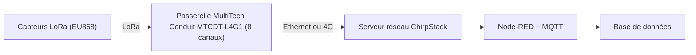

# Déploiement d'un réseau LoRaWAN autour d'une passerelle MultiTech

> *Master 2 project: private long-range low-power LoRaWAN network built around a MultiTech Conduit gateway (EU868), with a ChirpStack network server and a Node-RED/MQTT data pipeline. Status: in progress.*

## Contexte

Projet du Master 2 Capteurs, Électronique et Objets Connectés — Université de Montpellier, 2026 (en cours).
Objectif : déployer un réseau LoRaWAN privé longue portée et faible consommation, puis caractériser ses performances radio (RSSI, SNR, portée, taux de perte) pour des usages industriels : maintenance prédictive, bâtiment, agriculture.

## Architecture



## Étude de la couche physique et du protocole

- Modulation CSS, facteurs d'étalement SF7 à SF12, bande EU868
- Duty cycle
- Activation OTAA
- Sécurité AES-128

## Avancement

- [x] Phase théorique terminée : rapport technique et présentation LoRa/LoRaWAN
- [x] Protocole de mesure défini : RSSI, SNR et pertes en fonction de la distance et du SF
- [ ] Mise en service de la passerelle
- [ ] Premiers capteurs en OTAA
- [ ] Campagne de mesures et analyse

## Contenu du dépôt

```
docs/   rapport technique et présentation (à ajouter si le sujet le permet)
src/    configuration ChirpStack, flows Node-RED (à compléter)
data/   mesures RSSI/SNR (à compléter après la campagne)
```
